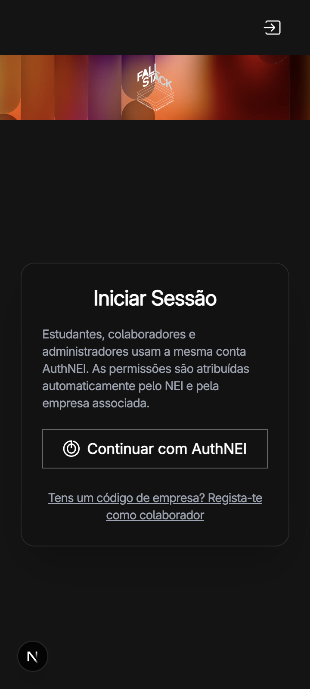
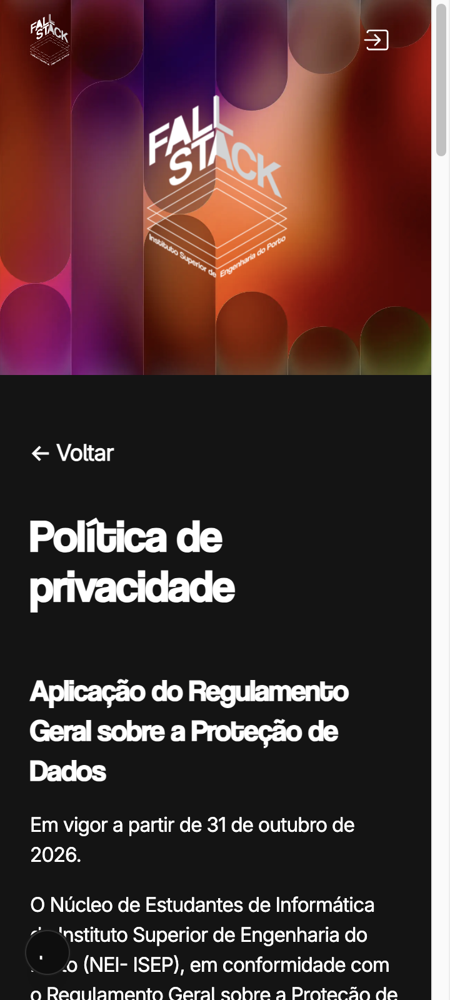
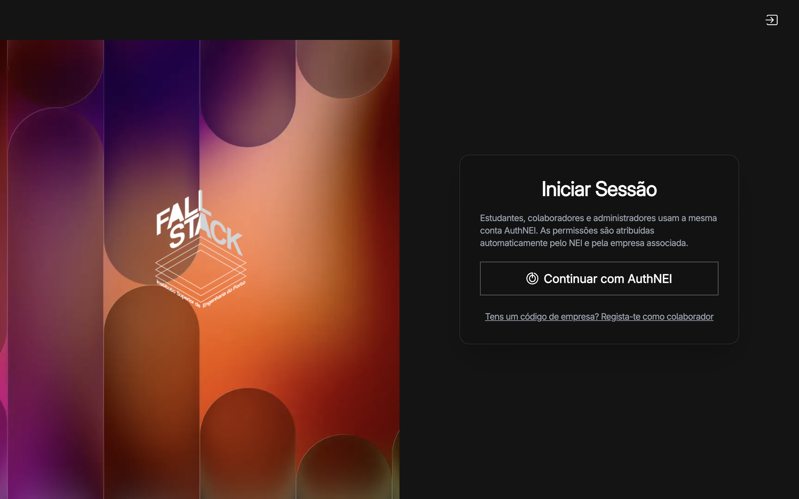

# Shared background verification (#484)

Local checks on 11 November 2026; design references are not QA evidence.

- Focused asset, CSP, company-content and homepage tests: 42 passed after
  integrating dev at 51da900.
- Full `pnpm test` before integrating the latest dev: 859 passed, 51 failed, 12 skipped. Nine failing files/suites
  require PostgreSQL at localhost:5432, which was unavailable. No shared DB
  was used, and no migrations or destructive data commands were run.
- `pnpm lint`: passed with five pre-existing formatting warnings. Final touched
  component check passed; the canonical Tailwind class warning was normalized
  by the repository commit hook.
- `pnpm typecheck` and `pnpm exec prisma validate`: passed.
- Production build and typecheck passed after integrating dev and correcting
  the hero accessible name to use the current branding fields.
- `git diff --check` and changed-source formatting checks: passed.

## Browser checks

Ran `pnpm dev` on task-owned port 3108 with example local configuration.
Auth and privacy returned 200, shared WebP and bundled fonts returned 200.
Auth without a session correctly returned 401 from the session API.

Inspected desktop auth at 1280 × 800, then auth and privacy at 360 × 800.
The desktop inspection caught an old 2025 date in `logo_white.svg`; the new
auth artwork now uses the current favicon mark instead. Final mobile captures:

Both final mobile pages had no horizontal overflow. Privacy computed styles:
Coolvetica headings, Inter body, opaque rgb(20,20,20) body. No rsms.me requests
on auth. Auth's initial desktop buffered layout-shift sum was 0.000207 before
the logo correction; this is not proof of zero CLS or a production benchmark.
CSS backgrounds reserve no geometry, and the auth banner reserves 24:5 space.

Preview privacy navigation timed out at 60 seconds during development
compilation; a subsequent snapshot showed the loaded 200 page and successful
artwork/fonts. Existing favicon/TopBar image sizing warnings were visible.

## Remaining verification

Authenticated student/company dashboards, public company data, privacy modal,
real devices and production render-cost comparison need a configured data/auth
environment. No full performance or all-panel accessibility claim is made.
The temporary countdown composite stays intact, as documented in ADR 0030.
The shared asset is smaller than both the combined old backgrounds and the
old hero; no extra runtime JavaScript or blur filter was introduced.

## Production CSP smoke check

Started the completed build with `NODE_ENV=production` on port 3108. Auth
returned 200 with enforced `script-src 'self' 'nonce-…' 'strict-dynamic'` and
`img-src 'self' data: blob:`. Shared artwork and bundled Inter loaded, 36 script
elements carried nonces, no external font request or horizontal overflow was
observed. Console errors were the expected anonymous session 401 responses;
no CSP violation was reported. This was a local build served by `next start`,
which warns about the standalone output configuration, not a deployed-container
check. Task-owned server and preview tabs were stopped/closed afterward.

