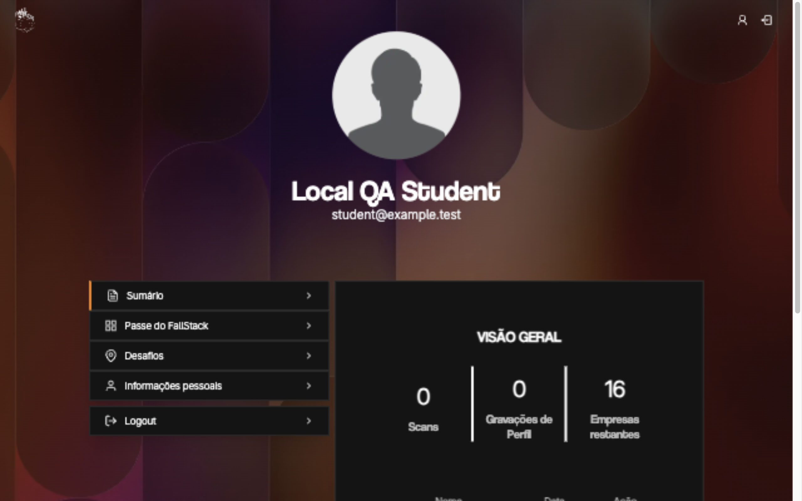
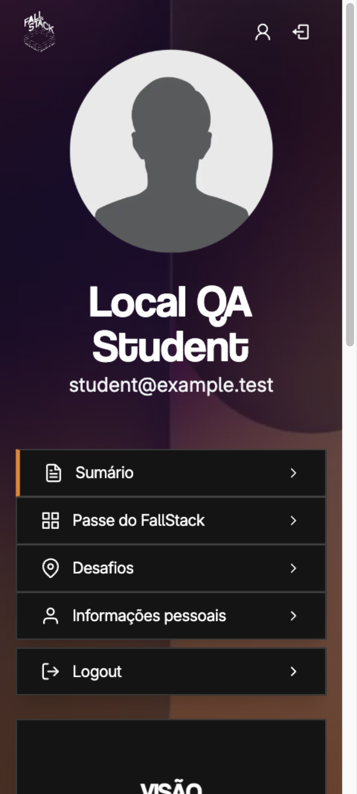
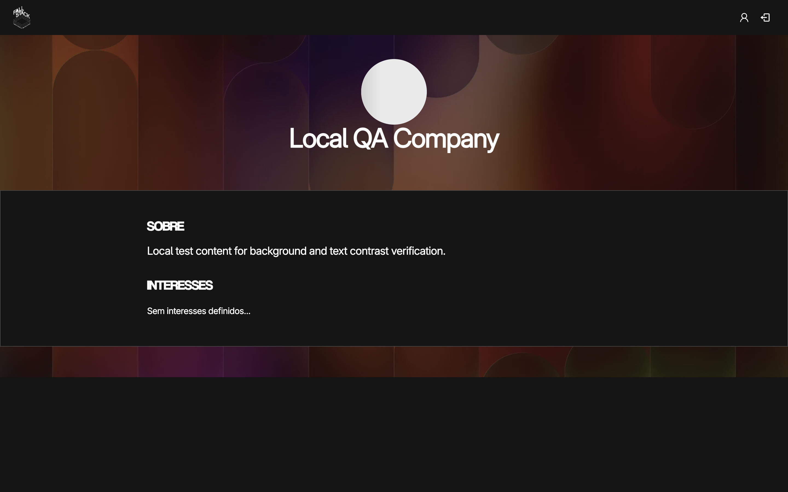
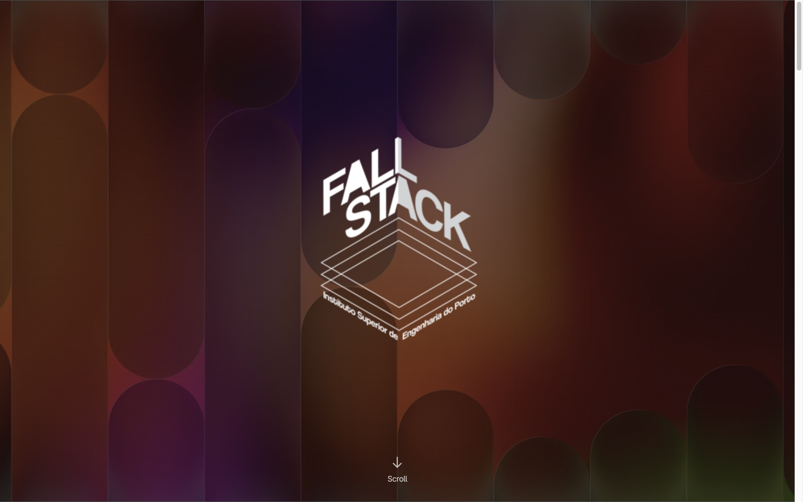
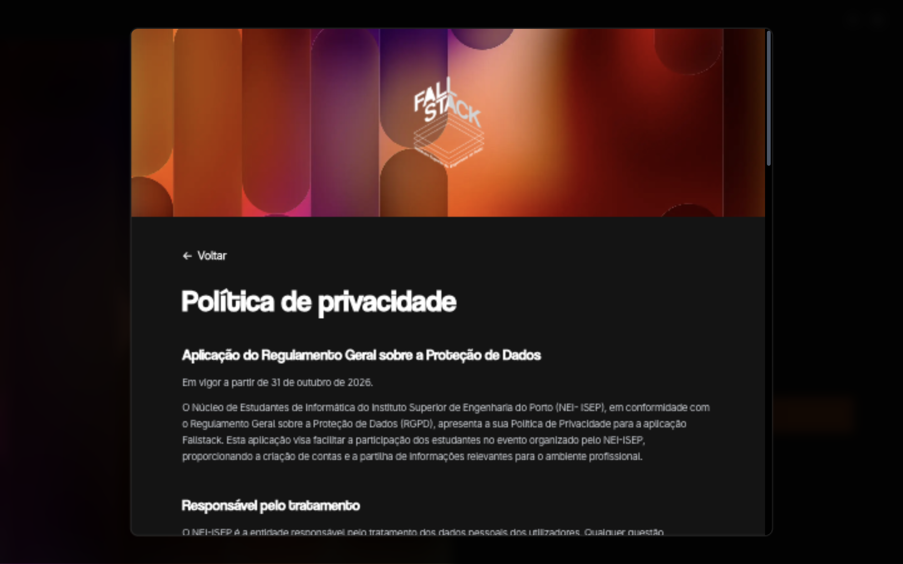
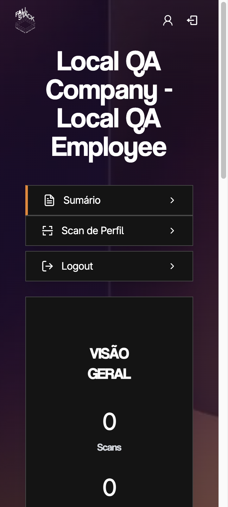
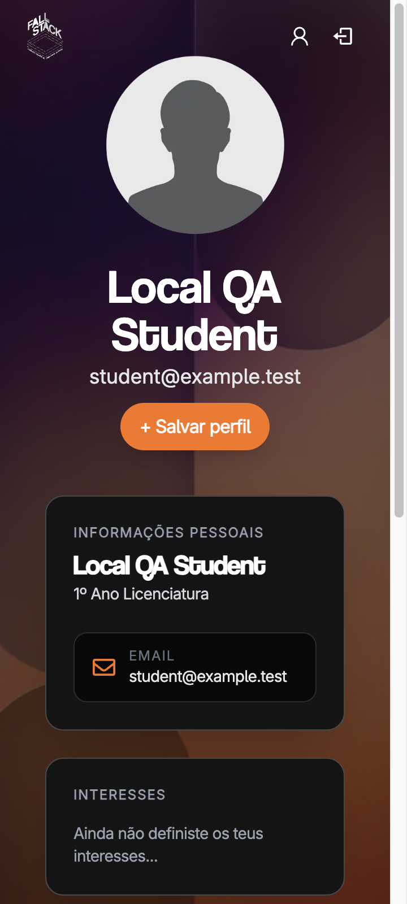

# Shared background verification (#484)

Local checks on 11 November 2026; design references are not QA evidence.

- Focused asset, CSP, company-content and homepage tests: 42 passed after
  integrating dev at 51da900.
- Full `pnpm test` at 4369ab4: 936 passed, 8 skipped, using an isolated
  PostgreSQL 16 database on localhost:54329 after applying migrations.
  This supersedes the earlier missing-database failures.
- `pnpm lint`: passed with five pre-existing formatting warnings. Final touched
  component check passed; the canonical Tailwind class warning was normalized
  by the repository commit hook.
- `pnpm typecheck` and `pnpm exec prisma validate`: passed.
- Production build and typecheck passed after integrating dev and correcting
  the hero accessible name to use the current branding fields.
- `git diff --check` and changed-source formatting checks: passed.

## Browser checks

Ran `pnpm dev` on task-owned port 3108 with example local configuration.
Auth and privacy returned 200, shared WebP and bundled fonts returned 200.
Auth without a session correctly returned 401 from the session API.

Inspected desktop auth at 1280 × 800, then auth and privacy at 360 × 800.
The desktop inspection caught an old 2025 date in `logo_white.svg`; the new
auth artwork now uses the current favicon mark instead. Final mobile captures:

Both final mobile pages had no horizontal overflow. Privacy computed styles:
Coolvetica headings, Inter body, opaque rgb(20,20,20) body. No rsms.me requests
on auth. Auth's initial desktop buffered layout-shift sum was 0.000207 before
the logo correction; this is not proof of zero CLS or a production benchmark.
CSS backgrounds reserve no geometry, and the auth banner reserves 24:5 space.

Preview privacy navigation timed out at 60 seconds during development
compilation; a subsequent snapshot showed the loaded 200 page and successful
artwork/fonts. Existing favicon/TopBar image sizing warnings were visible.

## Review follow-up

Authenticated browser verification uses a disposable local PostgreSQL database
and synthetic `example.test` identities, with locally signed app sessions.
It tests application rendering and existing role checks, not a live AuthNEI
login or production data. No shared services were changed.

Checked student summary (1280 and 360), company dashboard (360), public company
profile (1440), full showcase homepage (1440), and the privacy modal reached
through the real signup steps (1440). Artwork loaded under production CSP.
The company shell's viewport width caused 7 px overflow beside a 15 px
scrollbar; company/preview shells now use parent width. Short public company
pages now inherit the dark body rather than leaving a white viewport gap.
Company metric labels changed from white at 35% to #D1D5DC for readable contrast.

Final production build passed after the shell, body and contrast corrections.
Company and signed-preview at 360 px had scrollWidth = clientWidth = 345 px
(the remaining 15 px is the vertical scrollbar). Public company at 1440 px
had scrollWidth = clientWidth = 1440 px and body rgb(20,20,20).

The first production-auth check found no CSP errors; later 404 console entries
came from deliberately rejected raw preview tokens and a temporary baseline
asset, not the artwork treatment. A valid locally signed preview rendered the student panels successfully. No uploads or external AuthNEI calls are needed for #484.

A controlled scroll comparison on the same production homepage swapped the old
hero WebP with fixed attachment and the shared WebP with normal attachment.
Four alternating samples of 24 animation frames gave median frame intervals
16.7, 16.7, 16.7, 16.6 ms; p95 16.9, 17.1, 17.6, 17.4 ms respectively. Both
modes had zero frames over 34 ms. This narrow local check finds no material
scroll regression; it is not a full server-cost or real-device benchmark.
Both assets decode to a fixed image size; layout remains independent of image
loading. No new application JS or image filters were introduced.

Device discovery returned no devices: iOS `simctl` is unavailable and Android
SDK is absent. No PWA/service-worker behavior was changed; installed-device
verification remains part of #489 rather than blocking review of #484.

The secret scanner misclassified ADR prose beginning “auth banner” as a key.
A single commit/file/rule/line fingerprint in `.gitleaksignore` records that
false positive; a local redacted scan of the PR commit range then passed.
No rule or directory was excluded.

## Production CSP smoke check

Started the completed build with `NODE_ENV=production` on port 3108. Auth
returned 200 with enforced `script-src 'self' 'nonce-…' 'strict-dynamic'` and
`img-src 'self' data: blob:`. Shared artwork and bundled Inter loaded, 36 script
elements carried nonces, no external font request or horizontal overflow was
observed. Console errors were the expected anonymous session 401 responses;
no CSP violation was reported. This was a local build served by `next start`,
which warns about the standalone output configuration, not a deployed-container
check. Task-owned server and preview tabs were stopped/closed afterward.

## Final corrected captures

