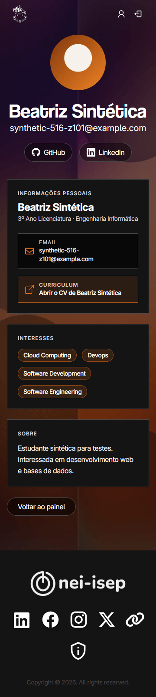

# Company dashboard and student profile verification (#516)

Evidence for restyling the company dashboard and the student profile views
that company employees reach.

- **Before:** `dev` at 773f0fc and 991638f (12 November 2026).
- **After:** this branch at 569818c (13 November 2026).

What changed: the dashboard and every student profile view now use the
shared artwork and dark panels instead of the old `bgHero` artwork and white
cards. The company dashboard mirrors the student dashboard's format
in its own code. Routes, tokens and permissions are unchanged.

## Environment

- `pnpm dev` on port 3000 with local Docker PostgreSQL 16, Redis and MinIO.
  No shared database or storage was used.
- Only synthetic data: the `pnpm seed` students (`A123`, `A456`) and the
  `Z1xx` students in [Test data](#test-data). No real student data, CVs or
  emails appear in the captures.
- Before captures: Zen/Firefox, real AuthNEI login. After captures and the
  sweep: headless Chrome with the `pnpm dev:session` identities and a fake
  camera. All at DPR 1.
- Viewports: 360 × 800, 400 × 900, 768 × 1024, 1440 × 900 and 1920 × 1080.

## Inventory

✓ captured · T recorded in text · – not captured

### Company dashboard (`/dashboard`)

Rendered by `CompanyProfileSectionContainer`. Only a session with an employee
profile linked to a company renders it; every other session gets the 404 page.

| ID  | Who              | State                                           | Before     | After               |
| --- | ---------------- | ----------------------------------------------- | ---------- | ------------------- |
| D1  | Employee         | Sumário, no saved students                      | ✓          | –                   |
| D2  | Employee         | Sumário, saved students listed                  | –          | ✓                   |
| D3  | Employee         | Interests saved: success, failure               | –          | T                   |
| D4  | Employee         | Scan de Perfil camera: allowed, denied          | –          | ✓ allowed, T denied |
| D5  | Employee         | Typed code: empty, invalid, duplicate, success  | ✓ messages | T                   |
| D6  | Employee         | Scan history: with entries, comment editor      | –          | ✓                   |
| D6  | Employee         | Scan history: empty                             | –          | –                   |
| D7  | Employee         | CV export (`cvs-guardados.zip`): success, error | –          | T                   |
| D8  | Student or admin | `/dashboard`: 404 page, no company navigation   | –          | T (same as S2)      |

### Student profile (`/student/[...data]`)

| ID  | Route                        | Who                     | Component                            | Before | After          |
| --- | ---------------------------- | ----------------------- | ------------------------------------ | ------ | -------------- |
| S1  | `/student/<code>`            | Employee, student saved | `CompanyViewProfileSectionContainer` | –      | T (same as S4) |
| S2  | `/student/<code>`            | Employee, not saved     | 404 page                             | ✓      | ✓              |
| S3  | `/student/<token>/preview`   | Employee, not saved yet | `PreviewProfileSectionContainer`     | –      | ✓              |
| S4  | `/student/<token>/preview`   | Employee, already saved | `PreviewProfileSectionContainer`     | ✓      | ✓              |
| S5  | `/student/<invalid>/preview` | Employee, not saved     | 404 page                             | ✓      | T (same as S2) |
| S6  | `/student/<code>`            | Admin without profile   | `PublicProfileSectionContainer`      | –      | T (same as S4) |

How employees reach these screens:

- **S4 is the screen employees normally see.** Saving a student from the
  camera or the typed code opens `/student/<token>/preview`, and the names in
  both saved lists (Sumário and Scan de Perfil) link to
  `/student/<code>/preview`. With a plain code, the preview renders only for
  an employee whose company saved the student.
- **S1 is reached only by typing `/student/<code>` in the address bar.**
  Nothing in the app links to it.
- **S3 is not reachable from the app.** Student QR codes hold the signed
  token and Wallet passes hold the student code, so the scanner and the
  typed code both save the student before opening the preview. S3 is opened
  here from a signed link without saving, and its branch is covered by
  tests.

The student's own profile (`ProfileSectionContainer`) belongs to #487 and is
not part of this inventory.

## Findings

### Fixed in this task

- **Typed-code messages covered the controls.** At 360 the message sat over
  the code field and Validar; at 1440 it covered the right end of the field.
  Validar also overlapped the typed text at 360, and repeated clicks stacked
  identical messages. Now no message covers the field, Validar or the
  camera, and repeats replace the message instead of stacking.
- **Server errors appeared in English.** Save failures other than a
  duplicate now show one Portuguese message instead of the server's text.
- **Student-addressed empty interests text.** The company-facing views said
  “Ainda não definiste os teus interesses…”; they now say “Este estudante
  ainda não indicou interesses.”.
- **Keyboard focus in the scanner.** See [Keyboard](#keyboard).

### Open, outside this task

- **Six-character codes.** The typed-code field in
  `CompanySavedProfilesSection` has `maxLength={4}`, so #514's six-character
  codes cannot be entered. #514 (PR #555) changes that line.
- **Duplicate saves by admin accounts.** `/api/saved` skips the duplicate
  check for sessions with an admin role (`allowDuplicate`), so the database
  answers 400 instead of the 409 that the scanner turns into “Este estudante
  já foi guardado anteriormente.”. An employee who is also an admin sees the
  generic save error. Tracked as a separate bug; duplicate checks here use an
  employee without an admin role.
- **Access check on the student route.** A possible access-control gap on
  `/student/[...data]` was reported privately to the Infraestruturas
  Informáticas coordinators, as [`docs/SECURITY.md`](../../SECURITY.md)
  asks.
- **Camera message over the camera box.** See
  [Messages over the camera and controls](#messages-over-the-camera-and-controls).
  Decision pending.
- **404 digits below 3:1 on the artwork.** The orange `404` on the shared
  not-found page (`src/app/not-found.tsx`) averages 3.5–3.9:1 against the
  artwork but drops to 2.8:1 over its lightest areas (1.8:1 at 360). S2, S5
  and D8 render it.
- **Avatar alt text in English.** The shared `UserImage` component labels
  every avatar “profile image”.
- **Unused QR modal.** `CompanyTab` and `ScanTab` have their own typed-code
  field and scanner, but their only entry point, `QRCodeButton`, is not
  rendered anywhere. This task restyles the reachable Scan de Perfil tab
  only.

## Accessibility and layout sweep

Run on 13 November 2026 with the test data at all five viewport sizes, as
the Employee (no admin role). D8 uses the Student and Admin sessions and S6
the Admin session. D1 was not run separately: it is the D2 frame with an
empty list.

### Horizontal overflow

`scrollWidth` against `clientWidth` of the page, plus any element inside
`<main>` that extends past the viewport. ✓ means neither happens.

| Screen                      | 360 | 400 | 768 | 1440 | 1920 |
| --------------------------- | --- | --- | --- | ---- | ---- |
| D2: Sumário, 18 saved       | ✓   | ✓   | ✓   | ✓    | ✓    |
| D4–D6: Scan, camera allowed | ✓   | ✓   | ✓   | ✓    | ✓    |
| D4: Scan, camera denied     | ✓   | ✓   | ✓   | ✓    | ✓    |
| D6: comment editor open     | ✓   | ✓   | ✓   | ✓    | ✓    |
| D8: student on `/dashboard` | ✓   | ✓   | ✓   | ✓    | ✓    |
| S1: Z101, Z102, Z103, Z105  | ✓   | ✓   | ✓   | ✓    | ✓    |
| S2: not saved (404)         | ✓   | ✓   | ✓   | ✓    | ✓    |
| S3: Z104, signed link       | ✓   | ✓   | ✓   | ✓    | ✓    |
| S4: Z101, Z102, Z103, Z105  | ✓   | ✓   | ✓   | ✓    | ✓    |
| S5: invalid token (404)     | ✓   | ✓   | ✓   | ✓    | ✓    |
| S6: Z101, Z102, Z103, admin | ✓   | ✓   | ✓   | ✓    | ✓    |

Long content: Z103's name wraps in the headings and is clamped to two lines,
with the full name in a tooltip, in both saved lists. Its email, links and bio
wrap. With the camera allowed, the video fills its 4:3 box at every width.

### Text contrast

Every text and background pair inside `<main>` on the screens above. Over the
artwork, the background is the artwork's lightest pixel under the
`artwork-readable` overlay (#6A494C), the worst case. Semi-transparent colours
are blended with what is behind them.

| Where                                                | Text on background         | Ratio    | Needed |
| ---------------------------------------------------- | -------------------------- | -------- | ------ |
| Action buttons (Guardar, Validar, Download CVs)      | #FFFFFF on #B1440A         | 5.67:1   | 4.5:1  |
| “SALVO” in the Sumário list                          | #F97316 on #141414         | 6.57:1   | 4.5:1  |
| Dashboard and profile subtitle, over the artwork     | #F3F4F6 on #6A494C         | 7.15:1   | 4.5:1  |
| Dashboard and profile name (45 px), over the artwork | #FFFFFF on #6A494C         | 7.86:1   | 3:1    |
| Table headers in both saved lists                    | #B9B9B9 on #141414         | 9.34:1   | 4.5:1  |
| “Curriculum” label in the CV button                  | #D1D5DC on #2B1E14         | 10.98:1  | 4.5:1  |
| Unselected interests                                 | #D0D0D0 on #141414         | 11.94:1  | 4.5:1  |
| Muted text and the code field placeholder            | #D1D3D4 on #141414         | 12.26:1  | 4.5:1  |
| Profile panel titles                                 | #D1D5DC on #141414         | 12.51:1  | 4.5:1  |
| GitHub and LinkedIn buttons, over the artwork        | #FFFFFF on #402C2E         | 12.98:1  | 4.5:1  |
| Selected interests                                   | #FFFFFF on #2C2C2C         | 13.97:1  | 4.5:1  |
| “Voltar ao painel”, over the artwork                 | #FFFFFF on #352526         | 14.54:1  | 4.5:1  |
| History comments                                     | #E8E8E8 on #141414         | 14.97:1  | 4.5:1  |
| Student interest chips                               | #FFFFFF on #362214         | 15.05:1  | 4.5:1  |
| Profile email                                        | #E5E7EB on #080808         | 16.18:1  | 4.5:1  |
| Bio, menu, headings and body text                    | #F3F4F6–#FFFFFF on #141414 | ≥16.74:1 | 4.5:1  |

No pair in the restyled screens is under 4.5:1. The only failure is the
shared 404 page's `404` digits (see [Findings](#open-outside-this-task)).

Focus indicators: the menu's orange ring measures at least 4.6:1 against the
real artwork pixels around each menu button, and the other rings are orange
or white on dark panels (at least 6.5:1).

### Keyboard

Tab and Shift+Tab through every screen above at 360 and 1440, waiting for
scrolling to finish after each key.

| Check                          | Result                                                                                                                        |
| ------------------------------ | ----------------------------------------------------------------------------------------------------------------------------- |
| Order                          | Follows the reading order: top bar, menu, tab content, list rows (name, then its comment button), footer.                     |
| Visible focus                  | Every stop in `<main>` matches `:focus-visible` and shows an outline.                                                         |
| Traps                          | None. Every walk leaves `<main>` for the footer, and Shift+Tab returns to the top bar.                                        |
| Hidden under the fixed top bar | Fixed. Shift+Tab used to hide the code field and Validar (360) and Download CVs (1440) under the bar; they now keep a margin. |
| Focus after a typed-code error | Fixed. Invalid and duplicate codes used to drop focus to the page; it now returns to the code field.                          |
| Comment editor                 | Opening moves focus to the comment field; Escape closes it and returns focus to “Editar comentário sobre …”.                  |

### Accessible names

Every link, button, field and image in `<main>` has a name, checked in
Chrome's accessibility tree. Links that open a new tab say so (“GitHub de
Beatriz Sintética (abre num novo separador)”); history buttons name the
student (“Editar comentário sobre …”); interest buttons expose
`aria-pressed`. The camera box is a group named “Câmara do leitor de QR
Code”, since the video itself has no name.

### Messages over the camera and controls

Typed-code messages, triggered twice each to check that copies do not stack:

| Message                       | 360 | 400 | 768 | 1440 | 1920 |
| ----------------------------- | --- | --- | --- | ---- | ---- |
| Empty: “Sem código inserido.” | ✓   | ✓   | ✓   | ✓    | ✓    |
| Invalid: `ZZZZ`               | ✓   | ✓   | ✓   | ✓    | ✓    |
| Duplicate: `Z101`             | ✓   | ✓   | ✓   | ✓    | ✓    |

✓: one message, announced as an alert, covering none of the code field,
Validar or the camera, with focus back in the code field.

Camera message: with the camera denied, “Não foi possível aceder à câmara…”
covers the bottom of the empty camera box (78 px at 360; a 132 × 102 px
corner at 1440) until it closes after 5 seconds. A QR scan error while the
camera is running would appear in the same place. Decision pending.

Other messages, checked at 360 and 1440: interests saved and not saved (D3)
and the CV export error (D7) each show one toast; the export button is usable
again afterwards. CV export success downloads `cvs-guardados.zip` with the
Z101 and Z103 CVs and `dados.csv`.

## Checks

Run on 13 November 2026 at 1acd657. Tests use an isolated local database.

| Check                                         | Result                                                                                                                                                                                   |
| --------------------------------------------- | ---------------------------------------------------------------------------------------------------------------------------------------------------------------------------------------- |
| `pnpm lint`                                   | 0 errors                                                                                                                                                                                 |
| `pnpm typecheck`                              | Pass                                                                                                                                                                                     |
| `pnpm test`                                   | 1,172 passed, 10 skipped, 3 failed. The 3 also fail on `dev` on this machine: two CSP tests read a local `.env` value, and one test starts `pnpm` as a subprocess, which Windows cannot. |
| `pnpm build`                                  | Compiles and generates all 54 pages. The final standalone copy fails on Windows without Developer Mode (symlinks); it runs in CI.                                                        |
| `pnpm exec prisma validate`                   | Pass                                                                                                                                                                                     |
| `git diff --check`, Prettier on changed `.md` | Pass                                                                                                                                                                                     |

Authorised flow, as the Employee with `pnpm dev`:

| Step                                    | Result                                                               |
| --------------------------------------- | -------------------------------------------------------------------- |
| Type `Z104` and press Validar           | Saved; its preview opens without “Salvar perfil”                     |
| Open the CV from a saved preview (Z101) | Opens in a new tab as a PDF                                          |
| Add a comment in Histórico de scans     | Saved, and still shown after a reload                                |
| Reopen Z104 from the Sumário list       | Opens `/student/Z104/preview`                                        |
| Download CVs                            | `cvs-guardados.zip` with the Z101, Z103 and Z104 CVs and `dados.csv` |

The Z104 save was removed afterwards.

Unauthorised flows. Each shows the 404 page, with no company navigation and
none of the student's data in the response:

- Signed out, Student and Admin on `/dashboard`.
- Employee on `/student/Z104` (not saved).
- Employee with an invalid, an expired and a wrongly signed preview token.
- Signed out with a valid preview token.

In a production build (`pnpm start`), the `/student/Z104` 404 and its
client-navigation response also contain none of Z104's data, and Student and
Admin get the 404 on `/dashboard`.

Not exercised here: a real camera and a real phone.

## Before captures

### D1: Sumário, no saved students

### S4: preview of a saved student (`A123`)

### D5: typed-code messages

### 404 page

## After captures

### D2: Sumário with saved students

### D4–D6: Scan de Perfil

### D6: comment editor

### S3: preview of a student not saved yet (Z104)

### S4: preview of a saved student (Z101)

### 404 page

### Not captured

- S1 and S6 look the same as S4 (S6 without “Voltar ao painel”). S5 and D8
  show the same 404 page.
- Messages (D3, D4 denied, D5, D7) were checked at 360 and 1440; see
  [Messages over the camera and controls](#messages-over-the-camera-and-controls).
- D1 and the empty scan history need Armis's `A123` and `A456` saves
  removed; the empty-list text is covered by the component tests.

## Test data

Synthetic students loaded into the **local** Docker database and MinIO only,
outside the repository. All emails are `synthetic-516-…@example.com`; avatars
are generated gradient images and CVs are one-page generated PDFs.

| Code      | Profile                                                                                                                                    | Saved by Armis                                   |
| --------- | ------------------------------------------------------------------------------------------------------------------------------------------ | ------------------------------------------------ |
| Z101      | Full: avatar, GitHub, LinkedIn, CV, short bio, 4 interests                                                                                 | Yes, with comment                                |
| Z102      | Minimal: no avatar, links, CV, bio or interests                                                                                            | Yes, no comment                                  |
| Z103      | Long everything: 98-character name, long email, 174/190-character links, 923-character bio with a blank line, tall avatar, CV, 6 interests | Yes, 950-character comment                       |
| Z104      | Avatar, GitHub only, CV, bio, 2 interests                                                                                                  | **No**                                           |
| Z105      | LinkedIn only, no avatar or CV, all 17 interests                                                                                           | Yes, short comment                               |
| Z111–Z122 | Minimal, “Estudante Sintético 01–12”                                                                                                       | Yes, staggered times, every third with a comment |
| A123      | From `pnpm seed`: no avatar, links, CV or interests                                                                                        | Yes                                              |
| A456      | From `pnpm seed`                                                                                                                           | Yes                                              |

With this data Armis has 18 saved students, enough to make both lists scroll.

Sessions, all minted by `pnpm dev:session` and linked to synthetic users:

| Session  | Identity        | User                                                                     |
| -------- | --------------- | ------------------------------------------------------------------------ |
| Employee | `local-armis`   | “Empregado Sintético”, an Armis employee **without** an admin role       |
| Student  | `local-student` | `Z100` (“Carolina Referência”, not saved)                                |
| Admin    | `local-admin`   | “Admin Sintético”, an admin-only account with no student or employee row |

### Recipes

| ID  | How to reach it                                                                                                                                                                                  |
| --- | ------------------------------------------------------------------------------------------------------------------------------------------------------------------------------------------------ |
| D1  | Employee → `/dashboard` (Sumário). The empty state needs Armis to have no saves; see the notes.                                                                                                  |
| D2  | Employee → `/dashboard` (Sumário) with the test data: 18 rows, scrolling, Z103's long name.                                                                                                      |
| D3  | Employee → Sumário → toggle interests → Guardar. Failure: DevTools → Network → Offline, then press Guardar.                                                                                      |
| D4  | Employee → Scan de Perfil → allow the camera, then reset the site permission and deny it.                                                                                                        |
| D5  | Employee → Scan de Perfil → typed code. Empty: press Validar with no text. Invalid: `ZZZZ`. Duplicate: `Z101`. Success: `Z104`, which saves it (undo it afterwards).                             |
| D6  | Employee → Scan de Perfil → Histórico de scans. Long comment: Z103's row. Empty: see the notes.                                                                                                  |
| D7  | Employee → Scan de Perfil → Download CVs. Error: DevTools → Network → block `cv-zip`, then press it.                                                                                             |
| D8  | Student or Admin → `/dashboard`.                                                                                                                                                                 |
| S1  | Employee → `/student/Z101`, `/student/Z102`, `/student/Z103` or `/student/Z105` (address bar).                                                                                                   |
| S2  | Employee → `/student/Z104` (not saved).                                                                                                                                                          |
| S3  | Employee → a signed preview link for Z104 without saving it. Get one with `POST /api/students/token` `{"code":"Z104"}` from the logged-in browser console, then open `/student/<token>/preview`. |
| S4  | Employee → click a student in either saved list, or `/student/<code>/preview`.                                                                                                                   |
| S5  | Employee → `/student/not-a-token/preview`.                                                                                                                                                       |
| S6  | Admin → `/student/Z101`, `/student/Z102` or `/student/Z103`.                                                                                                                                     |

Notes:

- **Empty saved list and history (D1, D6 empty).** Armis also has the A123
  and A456 saves from `pnpm seed`, so the empty state needs those removed as
  well as the test data.
- **Undo the D5 success save of Z104:** delete that `SavedStudent` row, or
  remove and reload the test data.
- Loading and removing the data: `bash load.sh` and `bash load.sh --cleanup`
  in the local `issue-516-test-data` folder kept next to the repository
  checkout.
